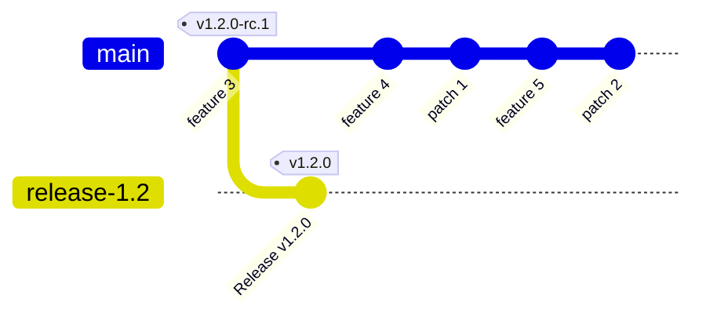

## Patch Releases

A patch release now follows exactly the same shape as the regular release above — by the time `vX.Y.0` ships, everything is already happening on `release-X.Y`. The only difference is where the line starts:

* `release-X.Y` already exists, created by the freeze at `vX.Y.0-rc.1`, so there is no branch to create.
* Patch commits are cherry-picked onto it, and the rc is cut by dispatching **from `release-X.Y`** — the same dispatch used for `rc.2` of the original release.


Let's assume that we've released `v1.2.0` and that development is ongoing.
We have introduced a couple of new features and some fixes to features that we have released 
in `v1.2.0`.

Once problems were found and fixed, a patch release is due.




1. Fixes reach the existing `release-1.2` branch from `main` through the backport batch, which cherry-picks what the [backport policy](./backports.md) admits and nothing else.

   The batch runs twice a week, so a fix merged into `main` reaches the line with the next batch that can pick it cleanly, without anyone asking for it.

   The `kind/backport` label and [`backport.yaml`](../../.github/workflows/backport.yaml) remain as a manual fallback that maintainers may still use; [Backport mechanics](./backport-mechanics.md) describes them.

   ```mermaid
   gitGraph
       commit id: "feature 3" tag: "v1.2.0-rc.1"
       branch release-1.2
       checkout release-1.2
       commit id: "Release v1.2.0" tag: "v1.2.0"
       checkout main
       commit id: "feature 4"
       commit id: "patch 1"
       commit id: "feature 5"
       commit id: "patch 2"
       checkout release-1.2
       cherry-pick id: "patch 1"
       cherry-pick id: "patch 2"
   ```

   Before the cut, `./backport-batch check --line release-1.2` (build it with `go build ./cmd/backport-batch`) has to exit 0: it exits 1 while a fix the rules take is neither on the line nor on the open batch pull request, and prints the URLs, and it prints the conflicts the batch deferred as warnings. See [Cherry-pick triage before a patch](./backport-mechanics.md#cherry-pick-triage-before-a-patch).

2. The maintainer cuts a release candidate (`v1.2.1-rc.N`) via the [`Cut Pre-release Tag`](../../.github/workflows/cut-prerelease.yaml) workflow (manual dispatch **from `release-1.2`**), which tags that branch's `HEAD`. CI builds and publishes the rc, pushes the `release-1.2.1-rc.N` staging branch, and runs the mandatory full `rc-e2e` job against the published tag.
3. Watch `rc-e2e` and wait for it to pass, then complete the other release checks. A successful manual `e2e-tag.yaml` run for `v1.2.1-rc.N` is also valid evidence if the latest `tags.yaml` run does not carry a green `rc-e2e`. **Optional:** press the `Generate RC Changelog` button ([`changelog-rc.yaml`](../../.github/workflows/changelog-rc.yaml)) to generate `docs/changelogs/v1.2.1.md` at rc time and bank it on the rc staging branch; promotion then reuses it instead of regenerating.
4. Once the checks are green, run [`promote-rc.yaml`](../../.github/workflows/promote-rc.yaml) (manual dispatch **from `main`**, as for every promotion, not from `release-1.2`) with that rc tag. It runs the same five jobs as a regular promotion: the dispatch first gates on the latest tag-push `rc-e2e` or a successful tag-correlated manual E2E run (`skip_e2e_gate` overrides it), verifies that `release-1.2` already carries the candidate-aware pipeline, then commits and publishes the rewritten packages tree under a run-specific temporary `promotion-*` tag, adds a second commit pinning the candidate on the `release-1.2.1` branch, drafts the `v1.2.1` release with the restamped assets, generates or picks up `docs/changelogs/v1.2.1.md` and commits it onto that branch, opens the parked `cozystack/website` docs PR (updating the existing `v1.2/` directory in place, since a patch does not promote `next/`), and opens the promote PR into `release-1.2` with only the `release` label. The promote PR body carries the same ✅/⚠️ E2E, changelog, and website-docs lines and runs no E2E by default; add `full-e2e` manually to force a repeat. As with a regular release every stable name is deferred to merge; retention protects the temporary candidate while this PR is open and, after it merges, while `release-1.2` still pins it — until finalize retags it stable.

   ```mermaid
   gitGraph
       commit id: "feature 3" tag: "v1.2.0-rc.1"
       branch release-1.2
       checkout release-1.2
       commit id: "Release v1.2.0" tag: "v1.2.0"
       checkout main
       commit id: "feature 4"
       commit id: "patch 1"
       commit id: "feature 5"
       commit id: "patch 2"
       checkout release-1.2
       cherry-pick id: "patch 1"
       cherry-pick id: "patch 2" tag: "v1.2.1-rc.1"
       branch release-1.2.1
       commit id: "Prepare release v1.2.1"
       checkout release-1.2
       merge release-1.2.1 id: "Pull request"
   ```

   Finally, when release is confirmed, the release sequence goes on.

5. Maintainer reviews the PR against the [Phase 4 checklist](./ci-pipeline.md#phase-4--review-and-merge-the-promote-pr), confirms the E2E-verification and changelog lines and notes the parked website-docs line, and merges it — **do not squash-merge**. GitHub removes the merged branch `release-1.2.1` (auto-delete-on-merge is enabled).
6. CI workflow triggers on merge (all consumer-visible or write-once side effects, after the rc E2E gate and PR review):
   1. Verifies the pinned packages candidate against the merged tree and the original rc artifact's container digests.
   2. Creates the tag `v1.2.1` at the newly created merge commit — write-once. The tag is published here for the first time, never moved.
   3. Cuts the write-once `api/apps/v1alpha1/v1.2.1` Go-module tag at the same commit.
   4. Publishes the release page (`draft` → `latest`; `latest` moves only if `v1.2.1` is the newest published stable).
   5. Retags the verified packages candidate and rc container images by digest to `v1.2.1` and publishes the stable `cozy-installer` chart — no container rebuild.
7. Once the release is published, merge the parked `cozystack/website` docs PR, then announce the release to the community.
