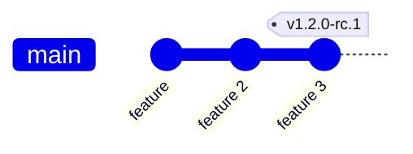
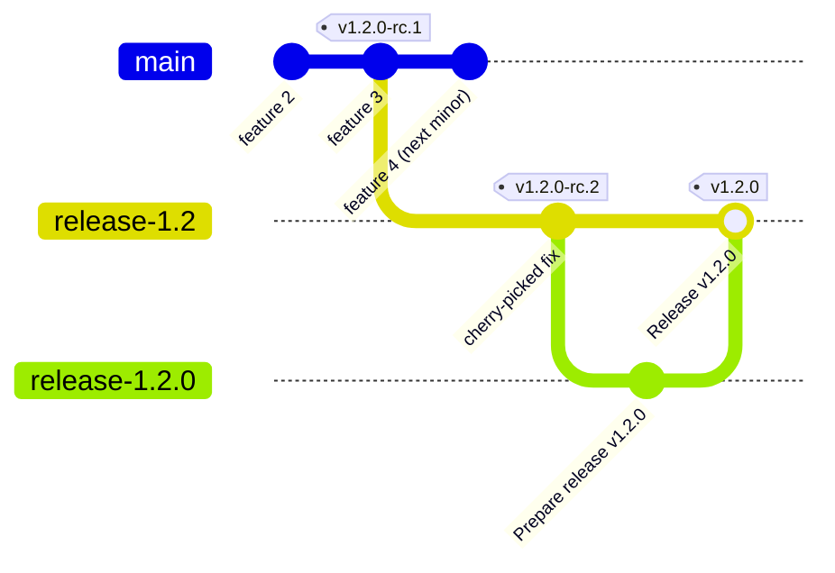

## Regular Releases

A regular release `vX.Y.0` is **promoted from a release-candidate that already passed e2e** — never tagged by hand and never rebuilt. The bytes shipped as `vX.Y.0` are the exact `vX.Y.0-rc.N` images, retagged by digest. We'll use `v1.2.0` as an example.



A regular release sequence runs as follows:

1. Cut the first release candidate (`v1.2.0-rc.1`) from the last good commit on `main`: run the [`Cut Pre-release Tag`](../../.github/workflows/cut-prerelease.yaml) workflow (manual dispatch **from `main`**) with the tag. It tags `main`'s HEAD as the CI app, then **creates `release-1.2` at that commit, freezing the line**; `tags.yaml` then builds the rc images, publishes the rc prerelease, pushes the digest-vendored `release-1.2.0-rc.N` staging branch, and runs its mandatory `rc-e2e` job by calling [`e2e-tag.yaml`](../../.github/workflows/e2e-tag.yaml) against that published tag.
2. Watch the rc's mandatory full E2E and wait for it to pass, then complete the other checks in [Pre-release verification checklist](./pre-release-checklist.md#pre-release-verification-checklist). If the latest `tags.yaml` run cannot provide a green `rc-e2e`, a successful manual dispatch of [`e2e-tag.yaml`](../../.github/workflows/e2e-tag.yaml) for the same tag is equivalent gate evidence. `main` is already open for the next minor, so anything landing there is **not** in this release: fixes for `1.2` are cherry-picked onto `release-1.2`, and a later rc is cut by dispatching the workflow **from `release-1.2`**. **Optional:** once the notes are worth reviewing, press the `Generate RC Changelog` button ([`changelog-rc.yaml`](../../.github/workflows/changelog-rc.yaml)) to generate `docs/changelogs/v1.2.0.md` now and bank it on the `release-1.2.0-rc.N` staging branch — so there is time to review and hand-edit it before promotion. Skipping the button changes nothing; promotion generates the changelog itself.

   ```mermaid
   gitGraph
       commit id: "feature"
       commit id: "feature 2"
       commit id: "feature 3" tag: "v1.2.0-rc.1"
       branch release-1.2
       checkout main
       commit id: "feature 4 (next minor)"
       checkout release-1.2
       commit id: "cherry-picked fix" tag: "v1.2.0-rc.2"
   ```

3. Once the checks are green, run the [`promote-rc.yaml`](../../.github/workflows/promote-rc.yaml) workflow (manual dispatch **from `main`**, the only branch it is dispatched from, whichever line the rc belongs to) with that rc tag. Its `parse` job verifies E2E before any staging: it accepts a successful `rc-e2e` job in the latest `tags.yaml` push run for the tag, or any retained successful manual `e2e-tag.yaml` run whose expanded E2E job name targets the tag. The emergency `skip_e2e_gate` input bypasses this check, logs a loud warning, and marks the promote PR with ⚠️. Before its first registry write, promotion also proves that the selected `main` or `release-X.Y` target already contains the candidate-aware PR gate, finalizer and trusted verifier; backport this pipeline to an existing maintenance branch before promoting its next patch. Promotion **creates no stable name before merge**: dispatch does write to the registry — it publishes one `promotion-*` packages candidate, and that tag is real and publicly listable — but it creates no `vX.Y.Z` tag, moves no `latest`, and publishes no stable installer, so nothing a consumer resolves changes until the PR merges. It:
   1. Rewrites the rc version substring to `1.2.0` and commits that exact tree, serializes its `packages/` directory under a run-specific temporary OCI tag, then adds a second commit pinning the candidate's immutable digest in the installer before pushing `release-1.2.0`. Container digests remain exactly the rc's; the two commits give the OCI revision an honest source SHA without pretending the artifact can contain its own digest.
   2. Drafts the `v1.2.0` release and uploads the (restamped) assets.
   3. Generates `docs/changelogs/v1.2.0.md` (in a parallel job, detached at the rc tag) — or, if you pressed the rc-time `Generate RC Changelog` button, copies the file already banked on the `release-1.2.0-rc.N` staging branch instead of regenerating — and commits it onto the `release-1.2.0` branch, so the changelog is reviewed as part of the promotion and finalize can publish the release with it already in place. Non-blocking: if generation fails the PR still opens, carrying a ⚠️ line that says the changelog is missing.
   4. Opens the `cozystack/website` "update managed apps reference" PR (`update-docs-v1.2.0` branch), generating the docs from the `release-1.2.0` staging branch via `FETCH_REF`. Non-blocking, and **do not merge that PR until `v1.2.0` is published** — merging early breaks the live site's version routing (see [Phase 3](./ci-pipeline.md#phase-3--update-website-docs-now-the-backstop)).
   5. Opens the `chore(release): promote v1.2.0-rc.N -> v1.2.0` PR into `release-1.2`, labelled `release` only. The PR body records whether E2E was verified or bypassed, plus ✅/⚠️ changelog and website-docs lines. E2E does not run on this promote PR by default because the immutable rc already passed the mandatory full suite; a maintainer may add `full-e2e` to run it again. The stable retag itself is deferred to the merge (step 5), so an abandoned promotion leaves no stable-named images and cannot wedge a re-promotion; retention protects the temporary candidate for as long as this release PR remains open, then may remove it after 30 days.

   The PR targets the maintenance branch, not `main`: `promote-rc.yaml` prefers `release-X.Y` whenever it exists, and since the rc freeze it always does. The digest-vendored `Prepare release` commit therefore stays on the release line instead of landing on `main`.

   ```mermaid
   gitGraph
       commit id: "feature 3" tag: "v1.2.0-rc.1"
       branch release-1.2
       checkout release-1.2
       commit id: "cherry-picked fix" tag: "v1.2.0-rc.2"
       branch release-1.2.0
       checkout release-1.2.0
       commit id: "Prepare release v1.2.0"
       commit id: "Pin promoted packages artifact"
       checkout release-1.2
       merge release-1.2.0 id: "Pull Request"
   ```

4. Maintainer reviews the PR and the draft release against the [Phase 4 checklist](./ci-pipeline.md#phase-4--review-and-merge-the-promote-pr): confirm the E2E-verification line is ✅ (or explicitly accept its ⚠️ bypass), the changelog line is ✅, and note the website-docs line — the `cozystack/website` docs PR that promotion parked, which stays unmerged for now. E2E does not run on this promote PR by default. Then merge — **do not squash-merge**, the stable tag must attach to a real merge commit. GitHub removes the merged branch `release-1.2.0` (the repo has auto-delete-on-merge enabled).
5. CI workflow triggers on merge (this is where every consumer-visible or write-once side effect happens, after the rc E2E gate and PR review):
   1. Pulls the pinned packages candidate by digest and verifies that it matches the merged `packages/` tree apart from the artifact's impossible self-reference, carries no rc image tags, and preserves the original rc artifact's container `repo@digest` set.
   2. Creates the tag `v1.2.0` at the newly created merge commit — write-once. The tag is published here for the first time, never moved.
   3. Cuts the write-once `api/apps/v1alpha1/v1.2.0` Go-module tag at the same commit.
   4. Ensures the `release-1.2` maintenance branch exists at the tag commit. Since the rc freeze created it, this is normally a no-op fast-forward: the merge commit is already its tip.
   5. Publishes the release page (`draft` → `latest`), using `docs/changelogs/v1.2.0.md` from the merge commit as the release body.
   6. Retags the verified packages candidate and rc container images by digest to `v1.2.0` (and `:latest` only when `v1.2.0` is the newest published stable), and publishes the stable `cozy-installer` chart — no container rebuild.
6. Once the release is published, merge the parked `cozystack/website` docs PR (opened back at promote time, step 3.iv) so the live site's version routing flips to `v1.2.0` — its versioned docs and `openapi.json` are on GitHub now. The maintainer can then announce the release to the community.



Note that `main` never receives the release commit. It forked away at the freeze and carries the next minor's work.
